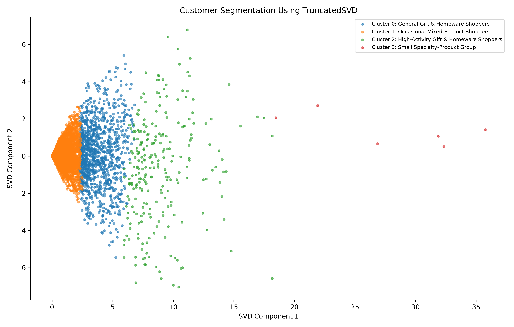

# DS5020 Mini-Project #1

## PCA vs. SVD for Retail Product Recommendations and Customer Segmentation

**Course:** DS5020  
**Student:** Vaenkatakrishnan Srinivasan  
**Project Type:** Individual  
**Roles:** Data Engineer and Machine Learning Engineer  
**Dataset:** UCI Online Retail II  

---

## 1. Project Overview

This project develops a personalized product recommendation system using customer purchasing behavior from the UCI Online Retail II dataset.

The main objective is to investigate dimensionality reduction using Principal Component Analysis (PCA) and Truncated Singular Value Decomposition (TruncatedSVD), with TruncatedSVD selected as the primary method because the customer-product matrix is highly sparse.

Product recommendations are generated using cosine similarity between product factor vectors. Performance is evaluated using Hit Rate@10 on held-out purchases and compared against a bestseller baseline.

The project also uses K-Means clustering to identify four customer segments and visualize their purchasing patterns.

### Project Objectives

- Clean and prepare retail transaction data.
- Build a sparse customer-product purchase matrix.
- Apply PCA and TruncatedSVD for dimensionality reduction.
- Generate top-10 personalized product recommendations.
- Compare recommendations against a bestseller baseline.
- Evaluate performance using Hit Rate@10.
- Measure model fitting time, memory usage, and recommendation runtime.
- Visualize customer segments in two dimensions.
- Interpret customer groups using popular products and countries.

### Project Results Summary

| Metric | Result |
|---|---|
| Original transactions | 1,067,371 |
| Cleaned transactions | 802,664 |
| Training customers | 5,474 |
| Training products | 4,534 |
| Matrix sparsity | 98.32% |
| Selected method | TruncatedSVD |
| Selected components | 50 |
| Recommendations generated | 54,740 |
| Evaluation customers | 1,916 |
| Bestseller Hit Rate@10 | 26.83% |
| TruncatedSVD Hit Rate@10 | 30.32% |
| Improvement | +3.49 percentage points |
| Recommendation generation runtime | 2.27 seconds |
| Customer clusters | 4 |

The selected TruncatedSVD model improved the observed recommendation Hit Rate@10 compared with the bestseller baseline.

---

## 2. Dataset Information

**Dataset:** Online Retail II  
**Source:** UCI Machine Learning Repository  
**URL:** https://archive.ics.uci.edu/dataset/502/online+retail+ii

### Original Dataset

| Dataset | Rows | Columns |
|---|---:|---:|
| Year 2009–2010 | 525,461 | 8 |
| Year 2010–2011 | 541,910 | 8 |
| Total | 1,067,371 | 8 |

### Dataset Columns

1. Invoice
2. StockCode
3. Description
4. Quantity
5. InvoiceDate
6. Price
7. Customer ID
8. Country

### Missing Values Before Cleaning

| Column | Missing Values |
|---|---:|
| Invoice | 0 |
| StockCode | 0 |
| Description | 4,382 |
| Quantity | 0 |
| InvoiceDate | 0 |
| Price | 0 |
| Customer ID | 243,007 |
| Country | 0 |

---

## 3. DE1: Data Loading and Inspection

**Status: Completed**

Both Excel sheets were loaded using pandas and combined into a single DataFrame.

The dataset was inspected to identify:

- Total rows and columns.
- Column names and data types.
- Missing values.
- Sample transaction records.

**Result:** 1,067,371 rows and 8 columns.

---

## 4. DE2: Data Cleaning

**Status: Completed**

Data cleaning was performed to remove invalid transactions before constructing the recommendation system.

### Cleaning Results

| Cleaning Step | Rows Removed |
|---|---:|
| Cancelled invoices | 19,494 |
| Non-positive quantities | 3,457 |
| Non-positive prices | 2,750 |
| Non-product codes | 4,551 |
| Missing Customer IDs | 234,455 |
| Missing descriptions | 0 |
| Total Removed | 264,707 |

The cleaning rules were applied sequentially. The removal counts represent additional rows removed at each step.

### Cleaning Decisions

1. Cancelled invoices were removed because they do not represent completed purchases.
2. Transactions with non-positive quantities were removed because they represent returns or invalid purchase quantities.
3. Transactions with non-positive prices were removed because they do not represent valid paid purchases.
4. Non-product codes, such as postage, discounts, and bank charges, were excluded from product recommendations.
5. Transactions with missing customer IDs were removed because customer-level purchase histories require identifiable customers.
6. Records with missing product descriptions were checked; no additional rows were removed at that stage.

### Cleaned Dataset Summary

| Metric | Value |
|---|---:|
| Original rows | 1,067,371 |
| Cleaned rows | 802,664 |
| Rows removed | 264,707 |
| Percentage removed | 24.8% |
| Percentage retained | 75.2% |
| Columns | 8 |
| Remaining missing values | 0 |

**Output:** `outputs/cleaning_log.csv`

---

## 5. DE3: Time-Based Train/Test Split

**Status: Completed**

The cleaned transactions were divided chronologically into training and testing data.

The cutoff used was **2011-10-09 12:50**.

Transactions before the cutoff were used for training, while later transactions were reserved for evaluation.

The split was completed before fitting the dimensionality reduction models to avoid training on future purchases.

### Split Results

| Metric | Value |
|---|---:|
| Cleaned transactions | 802,664 |
| Training transactions | 684,101 |
| Test transactions | 118,563 |
| Eligible held-out transaction rows | 52,582 |
| Eligible evaluation customers | 1,916 |
| Products appearing in eligible evaluation | 2,674 |

The eligible evaluation set focuses on previously unseen customer-product purchases involving customers and products represented in the training data.

### Outputs

- `outputs/split_summary.csv`
- `outputs/eligible_test_purchases.csv`

---

## 6. DE4: Customer-Product Matrix

**Status: Completed**

A binary customer-product purchase matrix was constructed using training transactions only.

- Rows represent customers.
- Columns represent products.
- A value of 1 indicates that a customer purchased a product during training.
- A value of 0 indicates no recorded purchase of that product.

The matrix was stored in Compressed Sparse Row (CSR) format to reduce memory usage.

### Matrix Results

| Metric | Value |
|---|---:|
| Customers | 5,474 |
| Products | 4,534 |
| Matrix dimensions | 5,474 × 4,534 |
| Nonzero entries | 417,742 |
| Representation | Binary CSR sparse matrix |

### Outputs

- `outputs/customer_product_matrix.npz`
- `outputs/customers.npy`
- `outputs/products.npy`

These intermediate files are generated locally and excluded from GitHub where specified by `.gitignore`.

---

## 7. DE5: Matrix Statistics

**Status: Completed**

The customer-product matrix is highly sparse because each customer purchases only a small fraction of the available products.

### Matrix Memory Comparison

| Metric | Value |
|---|---:|
| Matrix sparsity | 98.32% |
| Dense float32 matrix size | 94.68 MiB |
| CSR matrix size | 3.21 MiB |

The sparse representation requires substantially less storage than a dense float32 matrix.

These figures describe matrix storage requirements, not peak memory used during model fitting.

**Output:** `outputs/matrix_stats.csv`

---

## 8. Machine Learning

### ML1: Method Selection and Justification

**Status: Completed**

The primary dimensionality reduction method selected for this project is **TruncatedSVD**.

The training matrix contains 5,474 customers, 4,534 products, and 417,742 nonzero entries, with 98.32% sparsity.

#### Why TruncatedSVD?

TruncatedSVD was selected because:

1. It works directly with sparse matrices.
2. It does not require mean-centering the input matrix.
3. It avoids converting the sparse matrix into a dense representation.
4. It reduces dimensionality while capturing customer purchasing patterns.
5. It provides compact representations for recommendation generation.

#### Why Compare with PCA?

PCA was selected as the comparison method because it is another widely used dimensionality reduction technique.

PCA analyzes variation around the mean, whereas TruncatedSVD operates on the uncentered matrix.

For this implementation, PCA was fitted on a dense representation of the customer-product matrix.

**Primary method:** TruncatedSVD  
**Comparison method:** PCA  
**Random seed:** 42

---

### ML2: Dimensionality Reduction

**Status: Completed**

TruncatedSVD was fitted to the training-only customer-product matrix using the following component counts:

**k = 10, 20, 50, 100, 200**

The implementation uses randomized TruncatedSVD with `random_state=42` and `n_iter=5`.

#### Experimental Results

| Components (k) | Explained Variance (%) | Relative Reconstruction Error |
|---|---:|---:|
| 10 | 15.27 | 0.8989 |
| 20 | 19.34 | 0.8770 |
| 50 | 27.10 | 0.8337 |
| 100 | 35.73 | 0.7828 |
| 200 | 47.91 | 0.7047 |

#### Observations

As the number of components increases:

- Explained variance increases.
- Relative reconstruction error decreases.
- The representation retains more information but uses more components.

The final number of components was selected using recommendation performance rather than reconstruction quality alone.

**Selected model: TruncatedSVD with k = 50**

The k=50 and k=100 models achieved the same observed Hit Rate@10. The k=50 model was selected because it uses fewer components.

#### Outputs

- `outputs/svd_results.csv`
- `outputs/svd_reconstruction_error.png`
- `outputs/svd_embeddings_50.npy`
- `outputs/svd_components_50.npy`

Embeddings and components were also generated for the other tested values of k.

---

### ML3: Product Recommendations

**Status: Completed**

A personalized product recommendation system was developed using TruncatedSVD with 50 components and cosine similarity.

The recommendation process uses product factor vectors obtained from the SVD component matrix.

#### Recommendation Method

1. Load the trained SVD product factor vectors.
2. Compute cosine similarity between products.
3. Identify the 10 most similar products for each product.
4. For each customer, score candidate products using similarity to products previously purchased.
5. Exclude products the customer already purchased during training.
6. Rank candidate products by their scores.
7. Use a bestseller fallback when fewer than 10 positively scored recommendations are available.

#### Recommendation Results

| Metric | Result |
|---|---:|
| Customers | 5,474 |
| Products | 4,534 |
| SVD components | 50 |
| Product neighbors | 10 per product |
| Recommendations per customer | 10 |
| Total recommendations | 54,740 |
| Previously purchased products recommended | 0 |
| Fallback recommendations with non-positive similarity scores | 20 |

The validation confirmed that no previously purchased products were recommended.

#### Outputs

- `outputs/product_neighbors_50.npy`
- `outputs/cosine_recommendations_50.csv`

**Script:** `recommend_cosine.py`

---

### ML4: Model Evaluation

**Status: Completed**

Recommendation performance was evaluated using Hit Rate@10 on eligible held-out purchases.

A recommendation counts as a hit when at least one of the customer's top-10 recommended products appears in their eligible held-out purchases.

All models were evaluated using the same 1,916 eligible customers.

#### Hit Rate@10 Results

| Model | Hit Rate@10 (%) | Customers Hit |
|---|---:|---:|
| Bestseller baseline | 26.83 | 514 |
| SVD k=10 | 27.51 | 527 |
| SVD k=20 | 29.96 | 574 |
| SVD k=50 | 30.32 | 581 |
| SVD k=100 | 30.32 | 581 |
| SVD k=200 | 27.30 | 523 |
| PCA k=50 | 30.32 | 581 |

#### Key Findings

TruncatedSVD with 50 components achieved a Hit Rate@10 of **30.32%**, compared with **26.83%** for the bestseller baseline.

This represents an improvement of **3.49 percentage points**.

The k=50 and k=100 models achieved the same observed recommendation performance, so k=50 was selected as the more compact representation.

Increasing the number of components did not always improve recommendation performance.

#### Recommendation Job Timing

The recommendation-generation job was timed using `time.perf_counter()`.

| Metric | Result |
|---|---:|
| Selected model | TruncatedSVD, k=50 |
| Customers processed | 5,474 |
| Recommendations generated | 54,740 |
| Recommendation job runtime | 2.27 seconds |

The measured job includes product similarity computation, nearest-neighbor selection, recommendation generation, and CSV export.

The timing excludes SVD model fitting and subsequent recommendation validation.

#### Evaluation Limitation

The same held-out evaluation period was used to compare component counts and select k=50.

Therefore, the reported Hit Rate@10 is an exploratory model-selection result rather than performance measured on a separate untouched final test set.

**Output:** `outputs/evaluation_results.csv`

**Script:** `evaluate.py`

---

### ML5: PCA vs. TruncatedSVD Comparison

**Status: Comparison performed; memory measurement limitation documented**

Both methods were fitted using the same training customer-product matrix with 50 components and random seed 42.

TruncatedSVD was fitted directly to the sparse matrix.

PCA was fitted using a dense version of the same matrix with the randomized solver.

#### Comparison Results

| Metric | TruncatedSVD | PCA |
|---|---:|---:|
| Components | 50 | 50 |
| Fit time (seconds) | 0.1946 | 0.3389 |
| Python-tracked peak memory (MB) | 4.91 | 99.53 |
| Stored factors (MiB) | 1.91 | 1.93 |
| Explained variance (%) | 27.10 | 27.17 |
| Relative reconstruction error | 0.8337 | Not calculated |
| Hit Rate@10 (%) | 30.32 | 30.32 |
| Bestseller Hit Rate@10 (%) | 26.83 | 26.83 |

Fit times are from one recorded run and may vary between executions.

#### Component 1 Interpretation

**TruncatedSVD:** The first component represents a broad purchasing-activity pattern, with positive contributions from frequently purchased products. High-loading product codes include 85123A, 21212, and 22423.

**PCA:** The first component represents the strongest variation in customer purchasing behavior relative to the average customer. High-loading product codes include 21212, 20725, and 85123A.

Both methods show several common high-loading products, suggesting that they capture related purchasing patterns.

#### Memory Measurement Limitation

The reported peak-memory values were measured using Python's `tracemalloc`.

These values measure Python-tracked allocations rather than complete process peak memory.

The conversion of the sparse matrix to a dense array for PCA occurred before the `tracemalloc` measurement began.

Therefore, these values should not be interpreted as full process-memory peaks or complete memory costs of each method.

#### Comparison Conclusion

Both methods achieved the same observed Hit Rate@10 at k=50.

PCA explained slightly more variance, but TruncatedSVD was faster in the recorded fitting run and works directly with the sparse input matrix.

TruncatedSVD remains the preferred method because it avoids the dense input conversion required by the PCA implementation used here.

#### Outputs

- `outputs/pca_svd_comparison.csv`
- `outputs/pca_embeddings_50.npy`
- `outputs/pca_components_50.npy`
- `outputs/pca_mean_50.npy`

**Script:** `compare_models.py`

---

### ML6: Customer Segmentation and 2D Visualization

**Status: Completed**

Customer segmentation was performed using K-Means clustering on the 50-dimensional TruncatedSVD customer embeddings.

Four clusters were created using `random_state=42` and `n_init=10`.

The first two SVD components were used to visualize customers in a two-dimensional scatter plot.

#### Cluster Sizes and Segment Names

| Cluster | Customer Segment | Customers | Percentage |
|---|---|---:|---:|
| 0 | General Gift & Homeware Shoppers | 1,165 | 21.3% |
| 1 | Occasional Mixed-Product Shoppers | 4,045 | 73.9% |
| 2 | High-Activity Gift & Homeware Shoppers | 258 | 4.7% |
| 3 | Small Specialty-Product Group | 6 | 0.1% |
| **Total** | | **5,474** | **100%** |

The segment names are descriptive working labels based on the observed purchasing patterns. They are not independently validated marketing personas.

#### Cluster 0: General Gift & Homeware Shoppers

This group contains 1,165 customers.

Top products include 85123A, 21212, 22423, 85099B, and 20725.

The majority of customers are from the United Kingdom (1,064), followed by Germany (28) and France (19).

The cluster shows purchasing overlap across several common products.

#### Cluster 1: Occasional Mixed-Product Shoppers

This is the largest group, containing 4,045 customers.

Top products include 85123A, 22423, 22138, 84879, and 47566.

Most customers are from the United Kingdom (3,691), with smaller groups from Germany (62) and France (59).

This cluster represents the largest customer segment in the dataset.

#### Cluster 2: High-Activity Gift & Homeware Shoppers

This group contains 258 customers.

Top products include 21212, 20725, 85123A, 22382, and 20728.

The majority are from the United Kingdom (238), followed by Germany (6) and France (6).

Several leading products appear across a high proportion of customers in this smaller segment.

#### Cluster 3: Small Specialty-Product Group

This is the smallest cluster, containing only 6 customers.

Top products include 23300, 15060B, 21889, 22728, and 21843. All six customers purchased each of these products during training.

Four customers are from the United Kingdom, and two are from EIRE.

This is a distinct but very small group, so its interpretation should be treated cautiously.

#### Key Observations

- The majority of customers belong to Cluster 1.
- Cluster 3 contains only six customers and appears separated from the larger groups in the 2D map.
- Product purchasing patterns differ across clusters.
- Customers from the United Kingdom dominate all four clusters.
- The 2D map displays the first two SVD components, while clustering uses all 50 dimensions.
- Customer IDs are not displayed in the visualization.

#### Customer Segmentation Visualization



**Output:** `outputs/customer_clusters.png`

**Script:** `customer_map.py`

---

## 9. Reproducibility

### Programming Language

Python 3.13.7

### Libraries

The project uses:

- pandas
- numpy
- scipy
- scikit-learn
- matplotlib
- openpyxl

The complete environment dependencies are maintained in `requirements.txt`.

### Environment Setup

Open PowerShell in the project directory.

Create a virtual environment:

```powershell
python -m venv .venv
```

Activate the environment:

```powershell
.venv\Scripts\Activate.ps1
```

Install dependencies:

```powershell
python -m pip install -r requirements.txt
```

### Dataset Setup

Download the UCI Online Retail II dataset and place the Excel workbook at:

```text
data/raw/online_retail_II.xlsx
```

The raw dataset and virtual environment are excluded from Git using `.gitignore`.

### Rebuild the Project

Run the following commands in order:

```powershell
python build_matrix.py
python train_model.py
python recommend_cosine.py
python compare_models.py
python evaluate.py
python customer_map.py
```

These commands rebuild the data processing, model fitting, recommendations, evaluation, comparison, and customer segmentation outputs.

To rebuild only the customer-product matrix from the raw dataset:

```powershell
python build_matrix.py
```

### Random Seeds

Random state 42 is used for TruncatedSVD, PCA, and K-Means clustering.

### Main Output Files

**Data processing:**

- `outputs/cleaning_log.csv`
- `outputs/split_summary.csv`
- `outputs/eligible_test_purchases.csv`
- `outputs/customer_product_matrix.npz`
- `outputs/matrix_stats.csv`

**Dimensionality reduction:**

- `outputs/svd_results.csv`
- `outputs/svd_reconstruction_error.png`
- `outputs/svd_embeddings_50.npy`
- `outputs/svd_components_50.npy`

**Recommendations and evaluation:**

- `outputs/product_neighbors_50.npy`
- `outputs/cosine_recommendations_50.csv`
- `outputs/evaluation_results.csv`

**Model comparison:**

- `outputs/pca_svd_comparison.csv`
- `outputs/pca_embeddings_50.npy`
- `outputs/pca_components_50.npy`
- `outputs/pca_mean_50.npy`

**Customer segmentation:**

- `outputs/customer_clusters.png`

Generated `.npy` and `.npz` files are excluded from Git and can be recreated using the project scripts.

### Reproducibility Notes

- The training matrix is built using training transactions only.
- The same eligible evaluation customers are used for model comparison.
- Previously purchased products are excluded from recommendations.
- Random seeds are fixed for randomized algorithms.
- Execution times can vary depending on the computer and system load.

---

## 10. Project Deliverables

### Data Engineering

- [x] DE1: Data loading and inspection
- [x] DE2: Data cleaning and cleaning log
- [x] DE3: Time-based train/test split
- [x] DE4: Sparse customer-product matrix
- [x] DE5: Matrix statistics
- [x] DE6: Reproducible data processing script

### Machine Learning

- [x] ML1: Method selection and justification
- [x] ML2: Dimensionality reduction experiments
- [x] ML3: Cosine-similarity product recommendations
- [x] ML4: Hit Rate@10 evaluation and recommendation job timing
- [x] ML5: PCA vs. TruncatedSVD comparison
- [x] ML6: Customer segmentation and 2D visualization

### Project Files

| File | Description |
|---|---|
| `build_matrix.py` | Data cleaning, splitting, and matrix construction |
| `train_model.py` | TruncatedSVD experiments |
| `recommend_cosine.py` | Product recommendation generation |
| `evaluate.py` | Hit Rate@10 evaluation |
| `compare_models.py` | PCA and TruncatedSVD comparison |
| `customer_map.py` | Customer segmentation and visualization |
| `notebooks/project_analysis.ipynb` | Project analysis notebook |
| `requirements.txt` | Python dependencies |
| `README.md` | Project documentation |

---

## 11. Project Limitations

1. The recommendation system uses binary purchase histories rather than explicit customer ratings.
2. The model cannot directly recommend products absent from the training matrix.
3. Customers absent from the training matrix are not represented by the fitted customer embeddings.
4. The smallest customer cluster contains only six customers.
5. The PCA memory comparison uses Python-tracked allocations rather than full process peak memory.
6. Component count selection used the held-out evaluation period, so the reported performance is exploratory.
7. Bestseller fallback recommendations may have non-positive cosine scores because their ranking is based on popularity rather than positive similarity.
8. The customer segment labels are exploratory and should be validated before use in marketing campaigns.
9. Offline Hit Rate@10 does not establish improvements in actual purchases or revenue.

---

## 12. Dataset Reference

Chen, D. (2012). *Online Retail II* [Dataset]. UCI Machine Learning Repository.

https://doi.org/10.24432/C5CG6D

